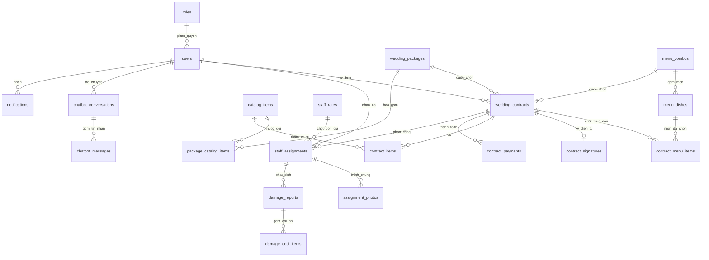
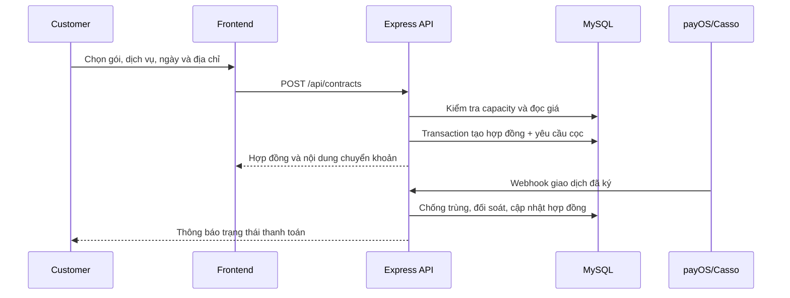

# Kiến trúc hệ thống

## Tổng quan

Hệ thống sử dụng mô hình nhiều lớp:

1. React/Vite cung cấp giao diện Public, Customer, Admin và Staff.
2. Express cung cấp REST API, xác thực JWT, RBAC và validation bằng Zod.
3. Service xử lý giá, capacity, xung đột lịch, đối soát thanh toán và chatbot.
4. Prisma truy cập MySQL bằng khóa ngoại, chỉ mục và transaction.
5. Integration kết nối OpenAI, Google Maps, payOS, Casso và Cloudinary khi có cấu hình.

## ERD

## Quy tắc nghiệp vụ quan trọng

- Backend luôn tính lại giá từ `wedding_packages` và `catalog_items`; không tin tổng tiền từ frontend.
- Mọi hợp đồng mới phải chọn một combo. Các món thay thế được lưu snapshot trong `contract_menu_items` để không bị đổi theo danh mục về sau.
- `selectedPackageItemIds` là các hạng mục trong gói mà khách giữ lại; hạng mục bỏ chọn được backend tính thành khoản giảm giá, không tin tổng tiền frontend.
- Customer phải ký điện tử trước khi thanh toán đặt cọc; chữ ký lưu URL ảnh, thời gian, IP và hash SHA-256 nội dung hợp đồng.
- Một ngày chỉ nhận số hợp đồng tối đa theo `daily_capacities` hoặc giá trị mặc định.
- Phân ca chạy trong transaction mức `Serializable` và kiểm tra cả khoảng đệm di chuyển.
- Check-in cần ảnh `BEFORE_SETUP`; check-out cần ảnh `AFTER_SETUP`.
- Bảng công chỉ tính ca `COMPLETED` có cả `actualCheckin` và `actualCheckout`.
- Webhook payOS và Casso lưu `externalEventId` duy nhất để chống xử lý lặp; payOS còn có API đồng bộ trạng thái dùng cho môi trường local.
- Chatbot chỉ nhận context gói cưới và FAQ cần thiết, không nhận mật khẩu, token hoặc secret.

## Luồng đặt tiệc

## Phân quyền

| Vai trò | Phạm vi chính |
| --- | --- |
| CUSTOMER | Gói cưới, hợp đồng của mình, thanh toán, chatbot, thông báo |
| STAFF | Ca được giao, ảnh hiện trường, check-in/out, hư hại, bảng công cá nhân |
| ADMIN | Toàn bộ dữ liệu vận hành, duyệt, điều phối, báo cáo và audit log |

Mọi API riêng tư đều kiểm tra JWT và vai trò ở backend. Các truy vấn hợp đồng, thanh toán, ca làm việc và báo cáo còn kiểm tra quyền sở hữu để ngăn IDOR.
